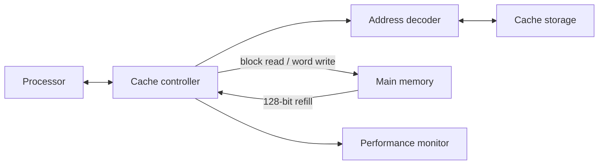
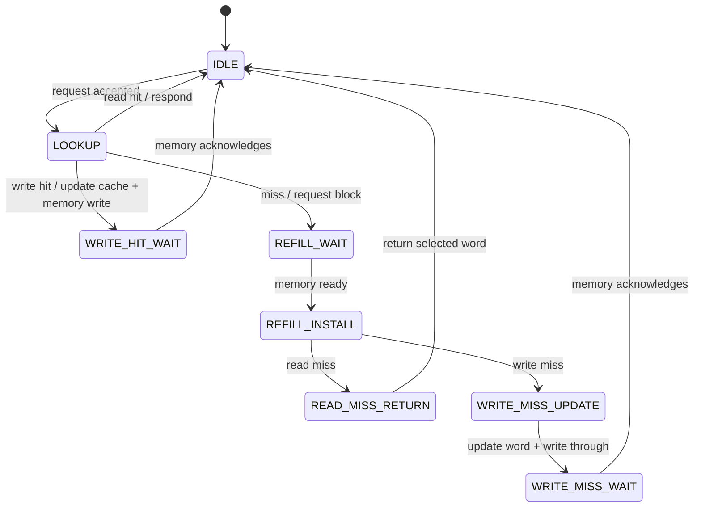

# Phase I Architecture — Direct-Mapped Cache

## Configuration

| Property | Value |
|---|---:|
| Address width | 32 bits |
| Capacity | 1 KiB (1024 bytes) |
| Mapping | Direct-mapped |
| Lines | 64 |
| Line/block size | 16 bytes |
| Words per line | 4 × 32-bit |
| Tag / index / byte offset | 22 / 6 / 4 bits |
| Word selector | Address bits [3:2] |
| Access alignment | 32-bit word aligned; [1:0] must be 00 |
| Write policy | Write-through and write-allocate |

Capacity check: 64 lines × 16 bytes per line = 1024 bytes.

## Address organisation

| Bits | Width | Meaning |
|---|---:|---|
| [31:10] | 22 | Tag |
| [9:4] | 6 | Cache line index |
| [3:2] | 2 | Word selector |
| [1:0] | 2 | Byte offset within a word |

The decoder exposes byte offset [3:0]. A cache hit requires both a valid selected line and equality between the stored tag and the request tag.

## Cache-line and memory organisation

Each line stores one valid bit, a 22-bit tag and 128 data bits (four 32-bit words). The memory model returns one aligned 16-byte block. Bus order is fixed: block_data[31:0] is the lowest-address word, followed by [63:32], [95:64] and [127:96].

## Read path

1. Controller captures the processor request, address and write data.
2. Decoder selects the line and extracts tag and word offset.
3. On a valid tag match, the selected word is returned as a hit.
4. On a miss, controller requests the full aligned 16-byte block.
5. After memory ready, the full line, tag and valid bit are installed.
6. The selected word is returned as one completed miss.

## Write policy

**Write-through + write-allocate.**

- Write hit: update the selected cache word and issue a 32-bit write to the same address in main memory. Respond after memory acknowledges the write.
- Write miss: fetch and install the full block, update the selected word, then write that word through to main memory. Respond after the write acknowledgement. Count this as one miss/access, not multiple accesses.

There are no dirty bits because every cache write is propagated to main memory.

## Block-level data flow

## FSM

## Reset, requests and performance

Reset is synchronous and active high. It resets controller protocol state, invalidates cache lines and clears performance counters. The behavioural memory array is initialized to zero at simulation start; reset does not erase stored memory words.

`cpu_req` is a request-valid level sampled once while the controller is idle. The requester must deassert it for at least one rising clock edge between distinct requests. Requests first asserted while busy are ignored, not queued. `cpu_ready` is a one-cycle completion pulse; `cpu_rdata` is valid for reads with that pulse.

The controller emits `access_complete` and exactly one of `hit_event` or `miss_event` on the completion cycle. A write miss with refill and write-through still counts as one processor access.
